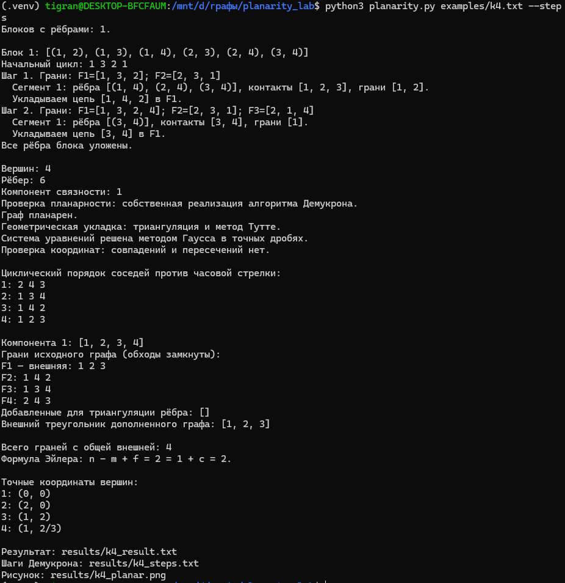
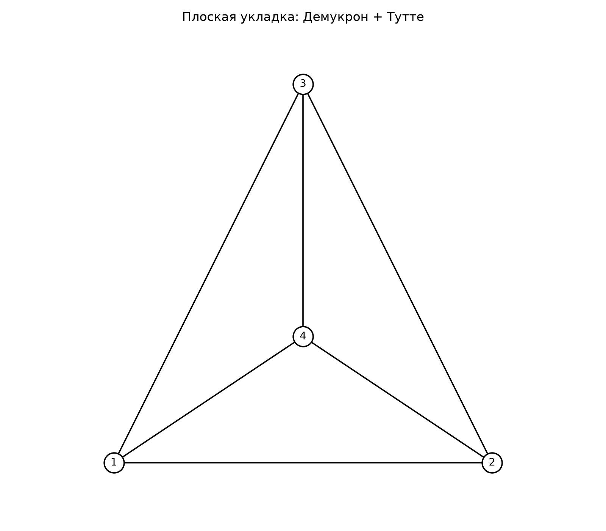
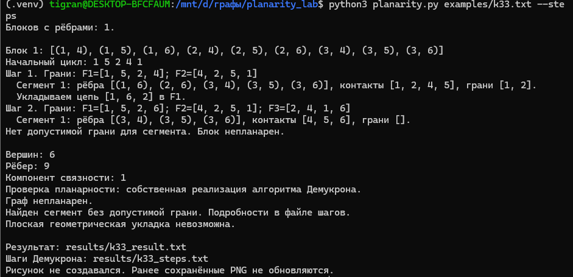

# Задание 6. Проверка планарности и плоская укладка графа

## Условие

Для заданного графа проверить его планарность с помощью одного из алгоритмов комбинаторной укладки. Если он планарен, с помощью геометрической укладки нарисовать его.

## Реализация

Для проверки планарности реализован алгоритм Демукрона-Мальгранжа-Пертюизе. Для геометрической укладки реализован метод Тутте с предварительной триангуляцией.

Алгоритмы находятся в файле `algorithms.py`. Готовые функции проверки планарности и построения укладки не используются. Matplotlib применяется только для рисования по вычисленным координатам.

### Комбинаторная укладка

1. Граф разбивается на двусвязные блоки. Мосты обрабатываются отдельно.
2. В каждом блоке с циклом выбирается начальный цикл, образующий две грани.
3. Для неуложенной части определяются сегменты и их контактные вершины.
4. Для каждого сегмента находятся допустимые грани, содержащие все его контакты.
5. Если допустимых граней нет, граф признаётся непланарным.
6. Иначе выбирается сегмент, из него выделяется цепь между контактами и укладывается в допустимую грань. Приоритет имеют сегменты с единственной допустимой гранью.
7. Процесс продолжается до укладки всех рёбер. Укладки блоков объединяются в точках сочленения.

Результат - циклический порядок соседей вокруг каждой вершины и граничные обходы граней.

### Геометрическая укладка

1. В грани планарной укладки добавляются вспомогательные рёбра до получения триангуляции.
2. Одна треугольная грань выбирается внешней. Её вершины получают фиксированные координаты.
3. Для внутренних вершин составляются уравнения Тутте: координаты каждой вершины равны среднему координат её соседей.
4. Система решается собственной реализацией метода Гаусса с точными рациональными числами.
5. На рисунке отображаются только исходные рёбра.

Компоненты связности располагаются отдельно. Для компонент из одной или двух вершин координаты задаются непосредственно.

## Входные данные

Простой неориентированный граф без петель и кратных рёбер.

Первая строка содержит `n m` - количество вершин и рёбер. Далее идут `m` строк `u v` с концами рёбер. Вершины нумеруются от 1 до n.

Пример для полного графа K4:

```text
4 6
1 2
1 3
1 4
2 3
2 4
3 4
```

Поддерживаются несвязные графы, деревья, мосты, точки сочленения и изолированные вершины.

## Установка и запуск

Требуется Python 3.9 или новее.

```bash
python3 -m venv .venv
source .venv/bin/activate
python3 -m pip install -r requirements.txt
```

Запуск с чтением графа из файла:

```bash
python3 planarity.py examples/k4.txt --steps
```

Ввод графа с клавиатуры:

```bash
python3 planarity.py --steps
```

Параметр `--steps` выводит шаги алгоритма Демукрона в терминал.

## Примеры работы

### Планарный граф K4

```bash
python3 planarity.py examples/k4.txt --steps
```

Результат: граф планарен. Построены комбинаторная и геометрическая укладки.



Полученный рисунок:



- [Входной граф](examples/k4.txt)
- [Полный результат](results/k4_result.txt)
- [Шаги Демукрона](results/k4_steps.txt)

### Непланарный граф K3,3

```bash
python3 planarity.py examples/k33.txt --steps
```

В ходе работы обнаруживается сегмент без допустимой грани. Граф признаётся непланарным, геометрическая укладка не строится.



- [Входной граф](examples/k33.txt)
- [Полный результат](results/k33_result.txt)
- [Шаги Демукрона](results/k33_steps.txt)

### Дополнительные примеры

| Файл | Граф | Результат |
| --- | --- | --- |
| `examples/cube.txt` | Граф куба | Планарен |
| `examples/tree.txt` | Дерево | Планарен |
| `examples/articulation.txt` | Граф с точками сочленения | Планарен |
| `examples/disconnected.txt` | Несвязный граф | Планарен |
| `examples/k5.txt` | Полный граф K5 | Непланарен |

## Выходные файлы

Результаты сохраняются в папку `results`:

- `<имя>_result.txt` - результат проверки, порядок соседей, грани и координаты;
- `<имя>_steps.txt` - шаги алгоритма Демукрона;
- `<имя>_planar.png` - рисунок планарного графа.

Для непланарного графа новый рисунок не создаётся.

## Файлы программы

| Файл | Назначение |
| --- | --- |
| `algorithms.py` | Демукрон, триангуляция, Тутте, метод Гаусса |
| `planarity.py` | Ввод, запуск, формирование отчёта и рисунка |
| `requirements.txt` | Зависимость для рисования |
| `examples/` | Входные графы |
| `results/` | Результаты работы |
| `screenshots/` | Скриншоты запусков |

## Ограничения

Программа рассчитана на небольшие учебные графы. Для крупных графов вычисления с точными дробями могут занимать значительное время, а подписи на рисунке - располагаться тесно.
